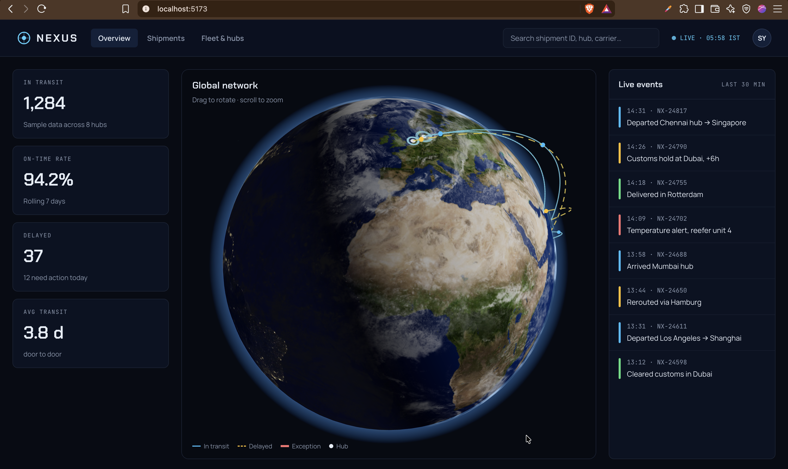

# NEXUS — Logistics Command Dashboard

A real-time logistics dashboard with an interactive 3D globe. Shipments travel between eight global hubs as glowing packets on curved routes, coloured by status, over a realistic Earth with day/night lighting, city lights, clouds and an atmosphere glow.



> Built with React 19, TypeScript, React Three Fiber and Tailwind CSS v4. All data is simulated in the browser, so the demo runs without a backend.

## Features

- **Realistic 3D Earth**: day texture, normal map for terrain relief, specular map so oceans reflect the sun and land stays matte
- **Day and night**: a fixed sun over India; a custom **GLSL shader** shows city lights only on the night side, with a soft twilight band
- **Drifting clouds** and a **view-dependent atmosphere glow** (second custom shader)
- **8 logistics hubs** placed from real latitude/longitude, each with a pulsing radar ring
- **Curved shipment routes** (quadratic Bézier arcs that rise higher for longer distances)
- **Moving packets** drawn with a single `InstancedMesh`: one GPU draw call for every shipment, positions updated in `useFrame` without React re-renders
- **Industry-standard status colours** (blue in transit, amber delayed, red exception, green delivered), always backed by a second signal (dashed or thicker lines, text labels)
- **Intro animation** with GSAP (skipped when the OS asks for reduced motion) and loading progress while textures download
- **Accessible UI**: semantic landmarks, keyboard focus styles, screen-reader description of the 3D view, live IST clock

## Tech stack

| Area      | Tools                                                  |
| --------- | ------------------------------------------------------ |
| UI        | React 19, TypeScript, React Router                     |
| Styling   | Tailwind CSS v4 with design tokens in `@theme`         |
| 3D        | three.js, React Three Fiber, drei, custom GLSL shaders |
| Animation | GSAP (intro), `useFrame` (per-frame motion)            |
| State     | Zustand (in progress)                                  |
| Tooling   | Vite, Oxlint                                           |

## Getting started

```bash
git clone https://github.com/srinath-yadav/nexus-logistics-dashboard.git
cd nexus-logistics-dashboard
npm install
npm run dev        # http://localhost:5173
```

Other scripts:

```bash
npm run build      # type-check and production build into dist/
npm run preview    # serve the production build locally
npm run lint       # Oxlint
```

## Project structure

```
src/
├─ components/   layout (Header, LiveClock) and overview panels
├─ pages/        one file per route
├─ three/        everything rendered inside <Canvas> (Earth, shaders, hubs, routes, packets)
├─ data/         sample hubs, shipments and metrics
├─ lib/          pure helpers (geo maths, status colours, time formatting)
├─ types/        shared TypeScript types
└─ constants/    app-wide constants (navigation, legend)
```

See **[ARCHITECTURE.md](ARCHITECTURE.md)** for how it's designed, the decisions behind it and the deployment plan.

## Roadmap

- [x] Header, routing and Overview layout
- [x] 3D globe: Earth, lighting, city lights, clouds, atmosphere, hubs, routes, packets
- [ ] Zustand store and live simulation (KPIs and events calculated from data)
- [x] Live events feed
- [x] Shipments table with filters and search
- [ ] Shipment detail page with route view and AI summary
- [x] Fleet & hubs page with 3D hub towers
- [ ] Deploy to Cloudflare

## Credits

Earth textures: [Solar System Scope](https://www.solarsystemscope.com/textures/) (CC BY 4.0)

## Author

**Srinath Yadav**: [srinathyadav.dev](https://srinathyadav.dev) · [GitHub](https://github.com/srinath-yadav) · [LinkedIn](https://www.linkedin.com/in/vayalpatisrinathyadav)
